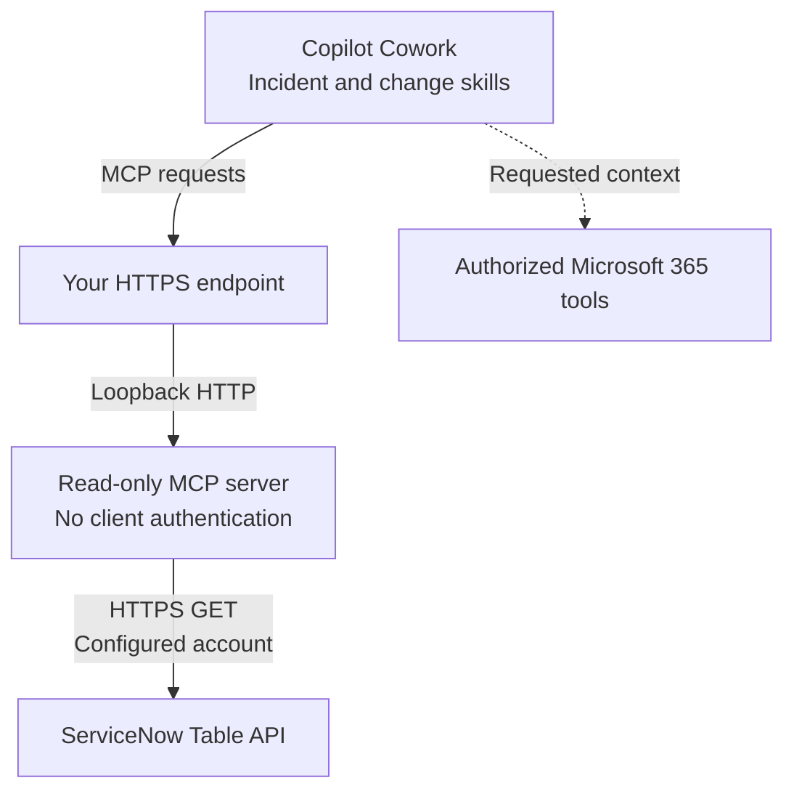

# ServiceNow for Cowork

ServiceNow for Cowork is a Microsoft Copilot Cowork plugin for read-only access to
ServiceNow incidents and change requests. It brings recent ticket details and
original source links into IT investigations, alongside any Microsoft 365 context
available through Cowork's separately authorized tools.

## Included skills

- [Incidents](plugin/skills/servicenow-incidents/SKILL.md): investigate workplace IT symptoms or look up a ticket.
- [Change requests](plugin/skills/servicenow-changes/SKILL.md): find changes and read their status.

## MCP tools

| Tool | Purpose |
|---|---|
| `search_incidents` | Find incidents by number, literal title substring, state, priority or assignee. |
| `get_incident` | Read one incident by number, including any recorded impact and workaround. |
| `search_changes` | Find change requests by state, type or assignment group. |
| `get_change` | Read one change request by number. |

All four tools are read-only and return source links. All reads are limited to
records updated within six months; searches return up to 20 matches, newest update
first. Incident search is not semantic or full-record search.

## Architecture

The plugin ZIP contains two skills and a remote MCP connector. Its MCP server
runs separately; this repository includes both.



## Get started

From the repository root, with Node.js 24 or later. No credentials are needed:

```sh
cd mcp-server
npm ci
npm run check
npm test
npm run check:distribution
npm run package -- --template
```

This creates `dist/template/servicenow-for-cowork.zip` at the repository root.
It is unconfigured and cannot be installed as-is. Follow [SETUP.md](SETUP.md)
to connect your instance, build a configured package and install it in Cowork.
Adding MCP to a coding assistant alone does not install it in Cowork.

**Access warning:** the server has no client authentication. Anyone who can reach
it can read through the configured ServiceNow account. Do not expose sensitive
records without a reviewed authentication and authorization design.

## Agent installation prompt

Paste into your coding agent from this checkout:

```text
Follow SETUP.md to prepare this plugin for my Microsoft Copilot Cowork.
Run the documented checks and build the template first. Preserve the read-only
tools, limits and skills; report failures.

Ask for my instance origin and the non-secret package settings in
package.example.json. Keep them in package.local.json, not the source manifest.
Have me supply credentials privately through a protected process environment
or secret manager, never in chat, commands, files or packages.

Explain the unauthenticated-endpoint risk before building a configured ZIP.
Obtain my explicit approval separately for deployment, access changes, sign-in
and Cowork installation. Do not assume permissions or expose sensitive records.
Follow SETUP.md's Cowork verification steps; local tests do not prove routing.
Do not push or publish.
```

## Credits and license

Credit goes to [fizamusthafa](https://github.com/fizamusthafa/servicenow-cowork-plugin)
for the original plugin this project builds on. This adaptation is maintained
by Lior Kamrat.

MIT; see [LICENSE](LICENSE) and [NOTICE](NOTICE).
