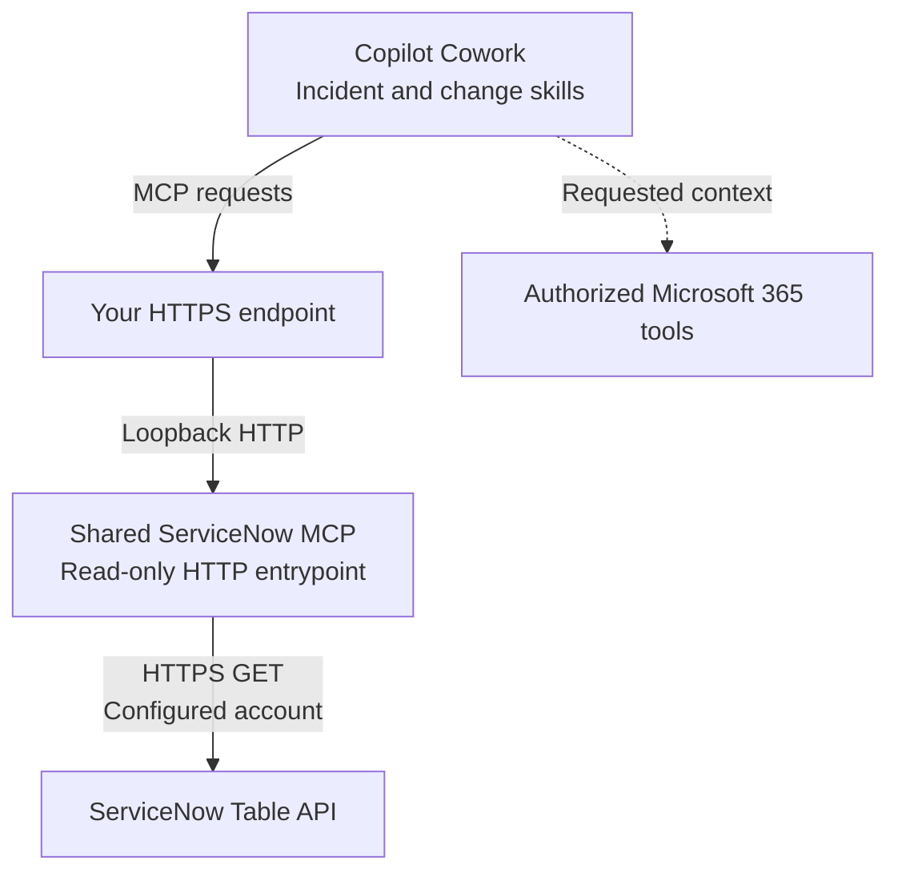

# ServiceNow for Cowork

ServiceNow for Cowork is a Microsoft Copilot Cowork plugin for read-only access to
ServiceNow incidents and change requests. It brings recent ticket details and
original source links into IT investigations, alongside any Microsoft 365 context
available through Cowork's separately authorized tools.

## Included skills

- [Incidents](plugin/skills/servicenow-incidents/SKILL.md): investigate workplace IT symptoms or look up a ticket.
- [Change requests](plugin/skills/servicenow-changes/SKILL.md): find changes and read their status.

## MCP tools

| Tool | Purpose |
|---|---|
| `search_incidents` | Find incidents by number, literal title substring, state, priority or assignee. |
| `get_incident` | Read an incident's description, impact and resolution notes by number. |
| `search_changes` | Find change requests by state, type or assignment group. |
| `get_change` | Read one change request by number. |

All four tools are read-only and return source links. All reads are limited to
records updated within six months; searches return up to 20 matches, newest update
first. Incident search is not semantic or full-record search.

Exact lookups return selected detail fields. Unlisted fields, including
`comments`, `work_notes` and `caller_id`, are excluded.

## Architecture

This repository is the thin Cowork client: two skills, the connector manifest,
generated tool descriptions and package tooling. The separately operated
[ServiceNow MCP](https://github.com/likamrat/servicenow-mcp) owns the backend.
Use its **read-only HTTP entrypoint**, never an administrative endpoint.



## Get started

From the repository root, with Node.js 24 or later. No credentials are needed:

```sh
npm ci
npm run check
npm test
npm run check:distribution
npm run package -- --template
```

This creates `dist/template/servicenow-for-cowork.zip` at the repository root.
It is unconfigured and cannot be installed as-is. Follow [SETUP.md](SETUP.md)
to select an approved shared MCP endpoint, build a configured package and install
it in Cowork.
Adding MCP to a coding assistant alone does not install it in Cowork.

**Access warning:** this connector uses no client authentication. Anyone who can
reach its endpoint can read through the server's configured ServiceNow account.
Personal plugin visibility does not protect the endpoint.

## Agent installation prompt

Paste into your coding agent from this checkout:

```text
Follow SETUP.md to prepare this plugin for my Microsoft Copilot Cowork.
Run the documented checks and build the template first. Preserve the read-only
tools, limits and skills; report failures.

Recover the existing installed app identity and connection URL before repairing
a connection. Use the shared ServiceNow MCP's read-only HTTP entrypoint and the
non-secret settings in package.example.json. Keep deployment settings in
package.local.json; credentials belong only in the backend's protected setup.
Check the pinned shared tool contract and explain the unauthenticated-endpoint risk.
Obtain my explicit approval separately for deployment, access changes, sign-in
and Cowork installation. Do not assume permissions or expose sensitive records.
Follow SETUP.md's native Cowork verification; a successful source-backed empty
result is valid, but missing tools or failed requests are not empty results.
Do not push or publish.
```

## Credits and license

Credit goes to [fizamusthafa](https://github.com/fizamusthafa/servicenow-cowork-plugin)
for the original plugin this project builds on. This adaptation is maintained
by Lior Kamrat.

MIT; see [LICENSE](LICENSE) and [NOTICE](NOTICE).
