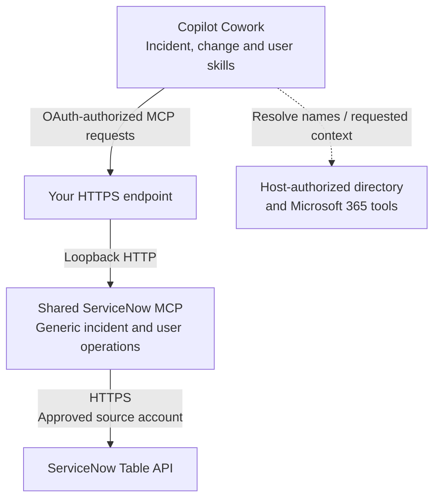

# ServiceNow for Cowork

ServiceNow for Cowork is a thin Microsoft Copilot Cowork plugin for recent
ServiceNow incident/change reads, incident operations and generic user profile CRUD.
One authenticated connector uses the shared ServiceNow MCP backend. It brings
ticket details and original source links into IT investigations, alongside any
Microsoft 365 context available through Cowork's separately authorized tools.

**Connection prerequisite:** installation requires an approved reachable HTTPS
MCP endpoint and a Microsoft token-store OAuth registration. This repository
does not provide hosting or register access. A locally running backend alone
cannot be reached by cloud-hosted Cowork; see [SETUP.md](SETUP.md) before installation.
Keep that backend available for the intended usage period, not just one
verification. Finishing a task does not stop the connection or require users
to disable and re-enable the plugin.

## Included skills

- [Incidents](plugin/skills/servicenow-incidents/SKILL.md): investigate workplace IT symptoms and perform authorized incident operations.
- [Change requests](plugin/skills/servicenow-changes/SKILL.md): find changes and read their status.
- [Users](plugin/skills/servicenow-users/SKILL.md): find, read, create, update or assess/delete source users with explicit authorization and source policy.

The skill identities are `servicenow-incidents`, `servicenow-changes` and
`servicenow-users`. Each folder matches its frontmatter name; the names omit
the transport label without changing the shared MCP backend or workflows.
Release 1.0.11 adds first-response enterprise grounding for investigation ownership
and system context, without requiring document keywords in the user's question.
It preserves the separation of existing-user assignment from account/access administration.
Existing assignees use the guarded
incident workflow under `Incident.Manage`; user creation and access changes still
require their own scopes and qualified policies. The connector, tool contract and
combined handoff-note safeguards are unchanged.

The [investigation workflow](plugin/skills/servicenow-incidents/references/investigation.md)
translates business intent into related activities or symptoms before choosing
literal title queries. The agent owns that reasoning; users need not know ticket
wording. Two distinct targeted searches can fall back to one bounded recent-title
sample, subject to source restrictions and requested filters. Explicit literal-title
requests remain literal. Candidate inspection grounds relevance; empty matches
prove neither instance-wide absence nor connection health.

When an investigation asks who should investigate or requests system/team context,
the skill also uses the current session's permitted Work IQ or Microsoft 365 tools
in that first response. General system-documentation and responsibility searches
are separate from incident-specific discussion; they do not require a ticket ID
or symptom match. At most three enterprise searches (including one fallback) and
three relevant content reads ground document findings and the recommendation.
Recorded assignment is not the recommended investigator, directory identity alone
does not prove responsibility, and a recommendation does not authorize assignment.
Excluded sources stay excluded; unavailable, denied, failed, empty or unreadable
evidence remains an explicit gap. Offline tests qualify these shipped instructions,
not actual model retrieval or a repair of an unknown client task failure.

For a name-only assignment, the incident skill uses the current host's authorized
Work IQ/directory capability, handles technical login/email internally, then
composes generic source user lookup/creation and incident update. The backend
does not depend on Work IQ or claim directory verification from supplied fields.
An email is a lookup/profile value, never the `assigned_to` reference itself.
The human can ask, "Could you assign this incident to Jordan Lee?" The instructions
carry the workflow, including dynamic resolution of future directory users:
no preconfigured person IDs, person allowlist or manually prepared source account.
All source mutations in this Cowork journey must use the delivered MCP tools,
not direct API workarounds. Required account/access authorization still applies.

## MCP tools

| Tool | Purpose |
|---|---|
| `search_incidents` | Find incidents by number, literal title substring, state, priority or assignee. |
| `get_incident` | Read an incident's description, impact and resolution notes by number. |
| `search_changes` | Find change requests by state, type or assignment group. |
| `get_change` | Read one change request by number. |
| `get_incident_schema` | Inspect current incident fields, reference targets, choices and policies. |
| `resolve_incident_assignee` | Resolve an exact source identity without selecting the first ambiguous match. |
| `create_incident` | Create an authorized incident using source-valid business fields. |
| `update_incident` | Update requested fields, including assignee, with the current version guard. |
| `delete_incident` | Delete an explicitly authorized incident with a current version and confirmation guard. |
| `get_incident_operation` | Read the requester's original operation evidence without replaying a write. |
| `get_user_schema` | Inspect source user fields and source-policy review requirements. |
| `lookup_users` | Find exact source identities without guessing or silently adopting a collision. |
| `get_user` | Read one user's ordinary profile, status, source link and version. |
| `create_user` | Create a source-valid inactive, locked human profile without password or access grants. |
| `update_user` | Change only requested ordinary profile fields with a current version guard. |
| `assess_user_delete` | Inspect deletion impact, protected identities and native effects. |
| `delete_user` | Delete the explicitly authorized, assessed source user with exact guards. |
| `get_user_operation` | Recover the caller's own original operation evidence without replay. |
| `inspect_user_access_policy` | Qualify a reviewed generic definition policy before creating an absent user. |
| `assess_user_access` | Inspect the exact user's missing eligibility stages and native effects under that policy. |
| `apply_user_access` | Apply only assessed, authorized missing membership/role and policy-required activation. |
| `get_user_access_operation` | Recover the caller's original access stages and uncertainty without repeating grants. |

This is the full packaged catalog. Runtime discovery is scope-filtered:
`Incident.Manage` exposes the original ten incident/change tools, `User.Manage`
exposes eight user profile tools, and `User.Access.Manage` exposes four generic
access tools. All three scopes expose twenty-two tools. Profile or access
management is not silently added to incident-only authorization, and profile
authorization does not imply permission to grant access.

The first four ticket lookup tools are read-only and return source links. Ticket reads
are limited to records updated within six months; searches return up to 20 matches,
newest update first. The backend's incident search is not semantic or full-record
search; the agent reasons about intent when selecting queries and inspecting results.

Exact ticket lookups return selected detail fields. Unlisted fields, including
`comments`, `work_notes` and `caller_id`, are excluded.
Incident detail includes `sys_mod_count` for guarded updates. Schema inspection
does not establish effective source permission. Assignment uses `update_incident`
with the resolved source identity; it is not restricted to a particular person.

An explicit assignment-with-findings request also requires supported journal append
and independent note readback. The [handoff instructions](plugin/skills/servicenow-incidents/references/handoff.md)
stop before an avoidable partial assignment when either capability is unavailable.
Use `update_incident` with `values.work_notes`, optionally alongside assignment,
for one guarded append. Its `work_note` evidence is separate from `record_fields`.
Caller-owned `get_incident_operation` independently reads the requested note,
not unrestricted history; ordinary `get_incident` still excludes journals.
Bounded or unreadable results preserve uncertainty. Assignment alone is not
notes delivery; never overwrite the description or substitute unsupported
customer-visible comments. Real source append and client execution still need
verification; a contract upgrade alone does not establish either.

Write tools require explicit authorization and any required native confirmation
gate. Preserve operation IDs and recover uncertain outcomes read-only; a version
preflight is not atomic compare-and-swap. Change requests remain read-only.

Generic user creation requires a reviewed source profile policy and creates no
login, role or group access. Creation alone is **not** assignment readiness.
The agent must qualify any required lifecycle/eligibility continuation before
creating an avoidable unusable account. Missing authorized access capabilities
are explicit gates, not permission to hide role grants in profile fields or
claim a completed create-to-assign workflow.
The generic continuation uses privately reviewed existing group/role definitions,
not preconfigured people. Policy inspection precedes avoidable creation; a fresh
caller-bound user assessment precedes access changes. Unapproved discovery
fingerprints are not a trusted policy. Partial stages and user identities remain
retained, and activation is included only when the actual reviewed policy requires it.

## Architecture

This repository is the thin Cowork client: three skills, the connector manifest,
generated tool descriptions and package tooling. The separately operated
[ServiceNow MCP](https://github.com/likamrat/servicenow-mcp) owns the backend.
Use its **restricted authenticated Cowork HTTP entrypoint**, never an
unrestricted administrative listener. The plugin does not own another backend, identity map
or assignment service. Other authorized agents can use the same generic backend
user and incident capabilities with their own permitted context providers.



## Get started

From the repository root, with Node.js 24 or later. No credentials are needed:

```sh
npm ci
npm run check
npm test
npm run check:distribution
npm run package -- --template
```

This creates `dist/template/servicenow-for-cowork.zip` at the repository root.
It is unconfigured and cannot be installed as-is. Follow [SETUP.md](SETUP.md)
to select an approved shared MCP endpoint, build a configured package and install
it in Cowork.
Adding MCP to a coding assistant alone does not install it in Cowork.

The connector requires `OAuthPluginVault`. Personal plugin visibility does not
authenticate backend requests, and an OAuth registration is not permission to
change an incident. Actual Cowork execution and independent source readback are
required before claiming the installed integration works.

## Agent installation prompt

Paste into your coding agent from this checkout:

```text
Follow SETUP.md to prepare this plugin for my Microsoft Copilot Cowork.
Run the documented checks and build the template first. Preserve the bounded
ticket reads and guarded incident/user operations; report failures.

Recover the existing installed app identity and connection URL before repairing
a connection. Use the shared ServiceNow MCP's authenticated Cowork entrypoint and the
non-secret settings in package.example.json. Keep deployment settings in
package.local.json; credentials belong only in the backend's protected setup.
Check the pinned shared tool contract and the Microsoft token-store OAuth reference.
Obtain my explicit approval separately for deployment, access changes, sign-in
and Cowork installation. Do not assume permissions or expose sensitive records.
Follow SETUP.md's native Cowork verification. A source-backed empty result proves
only that query, not incident retrieval or assignment. Missing tools and failed
requests are not empty results. Never replay an uncertain write.
Do not push or publish.
```

## Credits and license

Credit goes to [fizamusthafa](https://github.com/fizamusthafa/servicenow-cowork-plugin)
for the original plugin this project builds on. This adaptation is maintained
by Lior Kamrat.

MIT; see [LICENSE](LICENSE) and [NOTICE](NOTICE).
